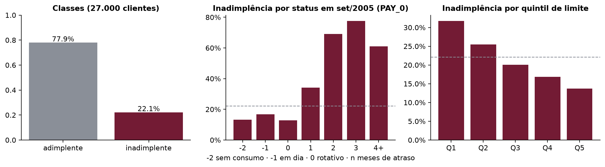
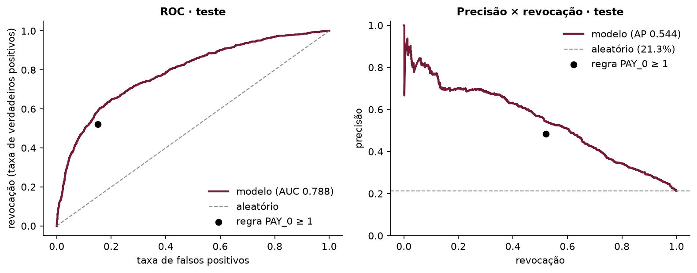
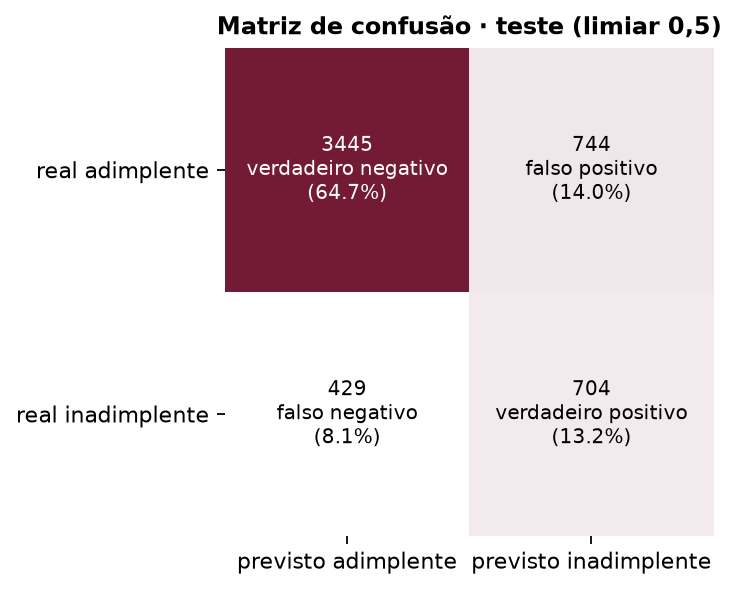
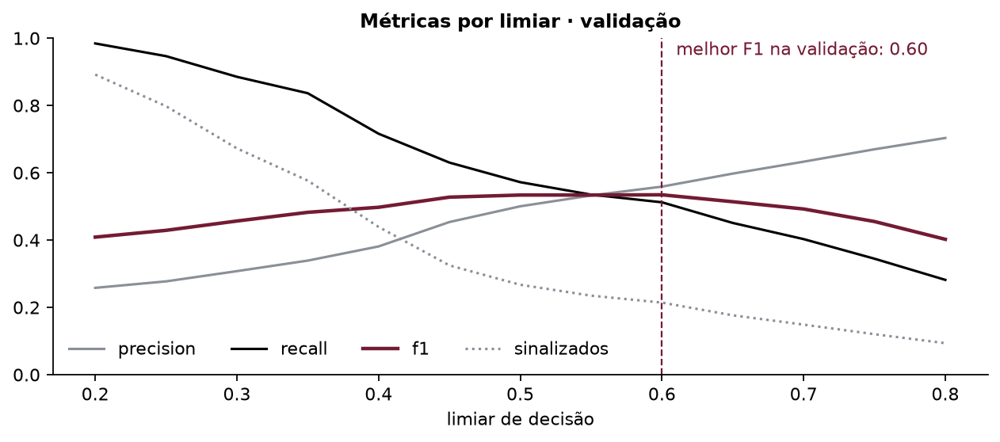
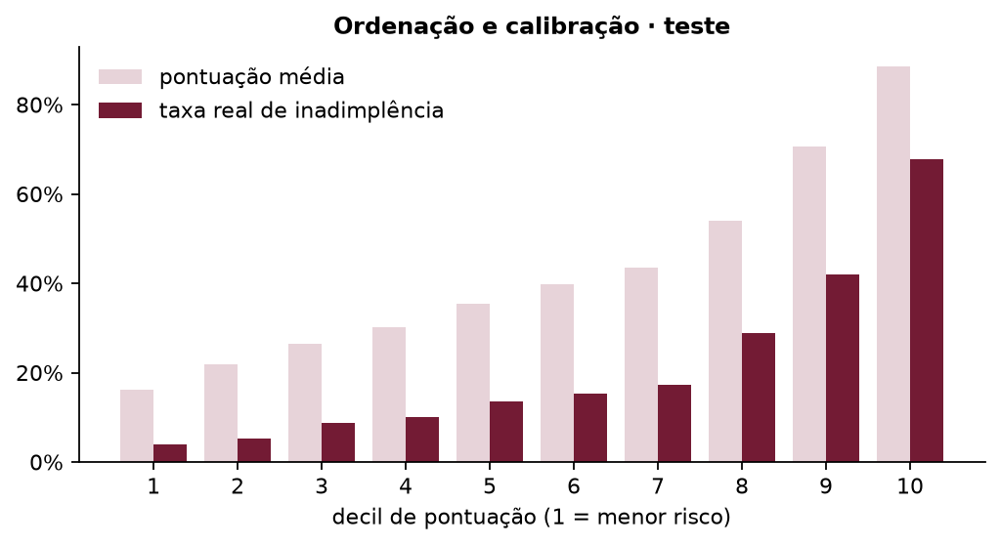
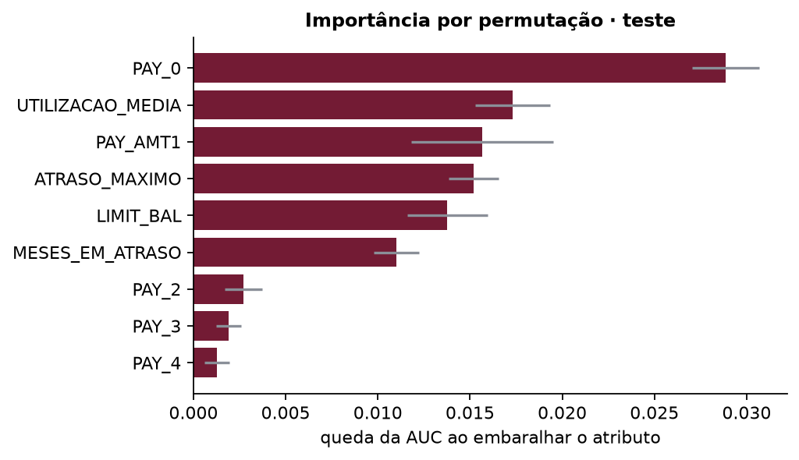

# Predição de Inadimplência em Cartão de Crédito

**Projeto N3 · projeto final de Aprendizagem de Máquina · turma 8NA · Católica de Santa Catarina**

Uma solução de aprendizagem de máquina que estima, para cada cliente de cartão de crédito, o risco de ele **deixar de pagar a fatura do mês seguinte**. O projeto cobre todo o caminho: preparação dos dados, modelagem, avaliação e uma demonstração em que uma entrada nova produz um resultado compreensível.

| | |
|---|---|
| Apresentação | [`reports/apresentacao_projeto_final.pdf`](reports/apresentacao_projeto_final.pdf) |
| Demonstração | [`src/demo.py`](src/demo.py), com instruções em [Demonstração de uso](#7-demonstração-de-uso) |
| Avaliação completa | [`notebooks/06_avaliacao_final.ipynb`](notebooks/06_avaliacao_final.ipynb) |
| Pipeline de treino | [`docs/pipeline_mlops.md`](docs/pipeline_mlops.md) |

**Integrantes:** Andre Gustavo Specht · Arthur Vinicius Hassuma · Gabriel F. Rocha · Nicolas Wajima · Pablo Arman Schuller · Victor da Rocha

## Sumário

1. [Problema e objetivo](#1-problema-e-objetivo)
2. [Dados](#2-dados)
3. [Preparação dos dados](#3-preparação-dos-dados)
4. [Modelagem](#4-modelagem)
5. [Avaliação e resultados](#5-avaliação-e-resultados)
6. [Erros e limitações](#6-erros-e-limitações)
7. [Demonstração de uso](#7-demonstração-de-uso)
8. [Apresentação](#8-apresentação)
9. [Estrutura do repositório](#9-estrutura-do-repositório)
10. [Reprodutibilidade e testes](#10-reprodutibilidade-e-testes)
11. [Equipe e contribuições](#11-equipe-e-contribuições)
12. [Considerações finais](#12-considerações-finais)
13. [Referências](#13-referências)

## 1. Problema e objetivo

Inadimplência é perda direta para um banco. Saber com antecedência quem tende a não pagar permite agir antes do atraso, em vez de cobrar depois.

**Objetivo.** A partir do perfil do cliente e dos seus últimos seis meses de fatura e pagamento, prever se ele ficará inadimplente no mês seguinte. É uma **classificação binária supervisionada** com classes desbalanceadas: 22% de inadimplentes.

**Quem poderia usar:**
- **Equipe de cobrança:** priorizar o contato preventivo com os clientes de maior risco.
- **Gestão de crédito:** revisar limites antes de aumentar a exposição.
- **Analista de risco:** entender por que um cliente recebeu aquela pontuação.

O modelo apoia a decisão, não a substitui. A pontuação ordena os clientes por risco, e são pessoas que decidem a ação.

## 2. Dados

**[Default of Credit Card Clients](https://archive.ics.uci.edu/dataset/350/default+of+credit+card+clients)**, UCI Machine Learning Repository, id 350 (Yeh & Lien, 2009). Licença CC BY 4.0, DOI [10.24432/C55S3H](https://doi.org/10.24432/C55S3H).

- **30.000 clientes** de um banco de Taiwan, de abril a setembro de 2005. Valores em dólar taiwanês (NT$).
- **23 atributos:**
  - limite de crédito (`LIMIT_BAL`);
  - sexo, escolaridade, estado civil e idade;
  - para cada mês, o status de pagamento (`PAY_0`, `PAY_2`..`PAY_6`: -1 em dia, n = meses de atraso), o valor da fatura (`BILL_AMT1..6`) e o valor pago (`PAY_AMT1..6`).
- **Alvo:** `default payment next month` (1 = inadimplente). 22,1% são inadimplentes.
- **Qualidade:**
  - não há valores ausentes nem IDs duplicados;
  - há códigos fora do dicionário: `EDUCATION` 0/5/6, `MARRIAGE` 0, e `PAY_x` = -2 e 0, que são frequentes mas não estão documentados;
  - de 8% a 10% de outliers nas colunas de fatura e pagamento.



**O atraso recente é o sinal mais forte.** Quem atrasou dois meses em setembro tem 69% de inadimplência, contra 13% a 17% de quem não estava atrasado. Quanto menor o limite, maior a inadimplência.

Para a demonstração, os dados foram divididos em três lotes de treino (27.000 clientes) e um conjunto de **3.000 clientes sem rótulo** (`data/raw/inferencia/novos_clientes.csv`). Esses 3.000 nunca participam do treino.

## 3. Preparação dos dados

| Tratamento | Justificativa |
|---|---|
| Códigos não documentados (`EDUCATION` 0/5/6, `MARRIAGE` 0) → "outros" | São 399 linhas sem significado no dicionário. Agrupar evita descartar clientes sem inventar uma categoria |
| `PAY_x` = -2 e 0 mantidos como "sem consumo" e "crédito rotativo" | Aparecem em milhares de linhas e têm taxa de inadimplência própria. Tratá-los como erro apagaria sinal real |
| Outliers mantidos | São valores reais de clientes de alto limite, e não erros de digitação. Os modelos usados são robustos a eles |
| Atributos derivados: `UTILIZACAO_ATUAL`, `UTILIZACAO_MEDIA`, `RAZAO_PAGAMENTO`, `MESES_EM_ATRASO`, `ATRASO_MAXIMO`, `TENDENCIA_FATURA` | Resumem seis meses de comportamento em sinais que um analista reconheceria. Cada um usa só a própria linha, então não há vazamento |
| Partição treino / validação / teste (60 / 20 / 20) por hash do ID | Cada cliente cai sempre na mesma partição, mesmo quando chegam dados novos. O teste nunca contamina o treino |
| Imputação, padronização e one-hot dentro de um `Pipeline`, ajustados só no treino | Evita vazamento e garante que a previsão aplique exatamente a transformação do treino |

O código está em `src/preprocessamento.py`, e a exploração detalhada no notebook `01_etl.ipynb`.

## 4. Modelagem

**Seleção de atributos por votação.** Três métodos independentes escolhem 10 atributos cada:
- teste estatístico (`SelectKBest` com ANOVA F);
- importância da Random Forest;
- eliminação recursiva (RFE) com regressão logística.

São eleitos os atributos com pelo menos 2 votos. Resultado: `LIMIT_BAL`, `PAY_0`, `PAY_2`, `PAY_3`, `PAY_4`, `PAY_AMT1`, `UTILIZACAO_MEDIA`, `MESES_EM_ATRASO` e `ATRASO_MAXIMO`. Nenhum atributo demográfico foi eleito, então o modelo não usa sexo, idade, escolaridade nem estado civil.

**Competição entre dois algoritmos**, com os mesmos atributos, os mesmos dados e a mesma métrica, medida na validação:

| Modelo | Hiperparâmetros | F1 | AUC-ROC |
|---|---|---|---|
| A · Regressão logística | `C=1.0`, `class_weight=balanced` | 0,529 | 0,753 |
| **B · Random Forest** | 150 árvores, `max_depth=8`, `min_samples_leaf=20`, `class_weight=balanced` | **0,544** | **0,783** |

A **Random Forest venceu**: ela capta interações e não linearidades, como o efeito do atraso, que muda de forma abrupta. A profundidade máxima e o mínimo de clientes por folha limitam o sobreajuste. Com `class_weight=balanced`, a classe rara recebe mais peso no treino.

A métrica principal é o **F1** da classe inadimplente. Responder sempre "adimplente" daria 78% de acurácia e não encontraria ninguém, então a acurácia não serve aqui.

O treino roda num pipeline automatizado que, a cada novo lote de dados, repete a seleção e a competição e só troca o modelo em uso se o novo for melhor. Detalhes em [`docs/pipeline_mlops.md`](docs/pipeline_mlops.md).

## 5. Avaliação e resultados

Protocolo:
- o limiar e as escolhas de modelo são feitos na **validação**;
- o **teste** (5.322 clientes que o modelo nunca viu, 21,3% inadimplentes) é usado só para a avaliação final;
- o modelo é comparado com duas alternativas simples.

| | Acurácia | Precisão | Revocação | F1 | AUC-ROC |
|---|---|---|---|---|---|
| Sempre "adimplente" | 0,787 | 0 | 0 | 0 | |
| Regra `PAY_0 ≥ 1` (atrasou no último mês) | 0,779 | 0,483 | 0,522 | 0,502 | |
| **Random Forest** (limiar 0,5) | 0,780 | 0,486 | **0,621** | **0,546** | **0,788** |

- **Melhor que a regra simples.** Com a mesma precisão da regra, o modelo encontra **704 inadimplentes, contra 591** da regra. Além disso, gera uma pontuação que permite escolher o ponto de operação.
- **Ordena bem o risco.** Nos 10% de maior pontuação, **67,7%** ficam inadimplentes, 3,2 vezes a média. Nos 10% de menor pontuação, só 3,9%.
- **O que mais pesa.** Primeiro o atraso no último mês (`PAY_0`), depois o uso do limite (`UTILIZACAO_MEDIA`), o valor pago (`PAY_AMT1`), o maior atraso do semestre e o limite de crédito.



| Matriz de confusão (teste, limiar 0,5) | Métricas por limiar (validação) |
|---|---|
|  |  |

**O limiar é uma decisão de negócio.** Na validação, o F1 é praticamente o mesmo entre 0,5 e 0,6. O que muda é a troca entre precisão e revocação:
- com limiar 0,3, o modelo encontra 89% dos inadimplentes, mas sinaliza 65% da base;
- com limiar 0,7, acerta 61% dos sinalizados, mas encontra só 44% dos inadimplentes.

| Ordenação e calibração (teste) | Importância por permutação (teste) |
|---|---|
|  |  |

Todos os números e figuras vêm de [`notebooks/06_avaliacao_final.ipynb`](notebooks/06_avaliacao_final.ipynb). O resumo em JSON está em `reports/evidencias/avaliacao_final.json`.

## 6. Erros e limitações

**Os dois erros não custam o mesmo.**

- **Falsos negativos (429): o erro caro**, um inadimplente tratado como bom pagador. **96%** deles não tinham atraso no último mês: são clientes "com cara de bom pagador", com pontuação mediana de 0,37. Com estes atributos, só dá para alcançá-los baixando o limiar, o que multiplica os falsos positivos.
- **Falsos positivos (744): o erro mais barato.** Em geral são clientes que já tinham atrasado (atraso máximo mediano de 2 meses) e pagaram no mês seguinte. O custo é uma ação preventiva desnecessária.
- **Erros por grupo.**
  - A revocação é parecida entre os sexos: 63% e 61%.
  - A taxa de falso positivo de quem tem ensino médio é maior: 23,7%, contra 16,2% na pós-graduação.
  - Antes de qualquer uso real, isso precisa ser monitorado.

**Limitações.**
- Os dados são de 2005, de um único banco de Taiwan. O modelo não se transfere para outro contexto sem novo treino.
- Há só seis meses de histórico e nenhuma informação de renda, emprego ou outras dívidas. Isso limita o teto do F1, em torno de 0,54.
- A pontuação **não é uma probabilidade calibrada**: o peso `balanced` a desloca para cima. Ela serve para ordenar clientes, não para ler como "X% de chance".
- O dataset não informa o custo de cada erro. Por isso o limiar de 0,5 é técnico, não de negócio.
- Os códigos não documentados foram interpretados. Outra leitura poderia mudar o resultado.

## 7. Demonstração de uso

O script `src/demo.py` avalia um cliente com o modelo em uso e explica o resultado em linguagem simples. O modelo treinado já está versionado no repositório, então **não é preciso treinar nada** para rodar a demonstração.

### Instalação

Requer **Python 3.12**, a mesma versão do CI.

```bash
git clone https://github.com/gabrielforster/mlops-credit-default-prediction.git
cd mlops-credit-default-prediction
git switch n3-machine-learning      # o projeto final está nesta branch

python3.12 -m venv .venv
source .venv/bin/activate           # Windows: .venv\Scripts\activate
pip install -r requirements.txt
```

### Execução

```bash
# Um cliente do arquivo de 3.000 clientes que o modelo nunca viu
python -m src.demo --id 11

# Um cliente descrito por você
python -m src.demo --modelo-json > cliente.json   # gera um cliente de exemplo
# edite cliente.json (por exemplo PAY_0, LIMIT_BAL, BILL_AMT1)
python -m src.demo --arquivo cliente.json

# Saída em JSON, para integrar com outro sistema
python -m src.demo --id 11 --json
```

Outros IDs estão em `data/raw/inferencia/novos_clientes.csv`; o `--id 24`, por exemplo, é um cliente de baixo risco. Um ID inexistente faz o script listar exemplos válidos.

### Exemplo de saída

O cliente de `--modelo-json` tem limite de 50 mil, dois meses de atraso em setembro e agosto, 75% do limite usado e nenhum pagamento no último mês:

```text
$ python -m src.demo --arquivo cliente.json
Modelo vigente : ciclo_20261116T223751Z_a2d3d2d2__random_forest (random_forest)
Pontuacao      : 86.5%  (risco muito alto)
Decisao        : PROVAVEL INADIMPLENTE  (limiar 50%)

O que mais pesou (pontos percentuais que o valor do cliente soma ou tira da pontuacao,
comparado ao valor tipico do treino):
   +20.7 p.p.  ATRASO_MAXIMO     cliente=       2  tipico=       0  (maior atraso no semestre (meses))
   +15.9 p.p.  PAY_0             cliente=       2  tipico=       0  (status de pagamento em set/2005 (-1 em dia, n = meses de atraso))
    +9.6 p.p.  MESES_EM_ATRASO   cliente=       2  tipico=       0  (meses com atraso no semestre)
    -2.1 p.p.  PAY_AMT1          cliente=       0  tipico=   2.100  (valor pago em set/2005 (NT$))
    +1.3 p.p.  UTILIZACAO_MEDIA  cliente=    0.75  tipico=    0.28  (fatura media do semestre / limite)
```

### Como ler a saída

- **Pontuação e faixa de risco.** As faixas são baixo (< 30%), moderado (30–50%), alto (50–70%) e muito alto (≥ 70%). A pontuação ordena os clientes por risco, mas não é uma probabilidade calibrada (seção 6).
- **Decisão.** Inadimplente ou não, no limiar de 50% do modelo.
- **O que mais pesou.** Para cada atributo usado pelo modelo, quantos pontos percentuais a pontuação muda se o valor do cliente for trocado pelo valor típico do treino (a mediana). Um valor positivo empurra para "inadimplente". A explicação é local, vale para aquele cliente, e funciona com qualquer algoritmo.
- **Entradas inválidas.** Uma entrada incompleta ou fora do dicionário da UCI, como `AGE: 7` ou `EDUCATION: 9`, é recusada com uma mensagem que aponta o campo.

A mesma lógica pode ser usada como função Python:

```python
from src.demo import avaliar_cliente, explicar, EXEMPLO
resultado = avaliar_cliente({**EXEMPLO, "PAY_0": -1})
print(explicar(resultado))
```

## 8. Apresentação

[`reports/apresentacao_projeto_final.pdf`](reports/apresentacao_projeto_final.pdf) tem 16 slides, organizados pelos critérios de avaliação:

| Slides | Conteúdo |
|---|---|
| 1 | Título e integrantes |
| 2–3 | Introdução: problema, quem usa, dados |
| 4 | Conceitos: métricas com classes desbalanceadas, modelos, boas práticas |
| 5 | Organização da atividade: pipeline e estrutura do repositório |
| 6–7 | Preparação e modelagem: tratamentos, votação de atributos, competição |
| 8–11 | Avaliação: comparação com alternativas simples, matriz de confusão, limiar, ordenação, importância, erros e limitações |
| 12 | Demonstração de uso |
| 13 | Criatividade: retreino automático, promoção com critério, rastreabilidade |
| 14 | Contribuição de cada integrante |
| 15 | Considerações finais e trabalhos futuros |
| 16 | Referências |

**Roteiro sugerido para a demonstração ao vivo** (slide 12):

1. `python -m src.demo --id 11`: um cliente real nunca visto, de risco moderado.
2. `python -m src.demo --arquivo cliente.json`: o exemplo de risco muito alto.
3. Editar `cliente.json` ao vivo, trocando `"PAY_0": 2` por `"PAY_0": -1` (pagou em dia), e rodar de novo para mostrar a pontuação cair.
4. Editar `"AGE": 7` para mostrar a validação da entrada.

A fonte dos slides é `reports/apresentacao_projeto_final.html`. As figuras ficam em `reports/figuras/` e são geradas pelo notebook 06. Para gerar o PDF de novo depois de editar:

```bash
chromium --headless --no-pdf-header-footer \
  --print-to-pdf=reports/apresentacao_projeto_final.pdf reports/apresentacao_projeto_final.html
```

## 9. Estrutura do repositório

```text
config/config.yaml        parâmetros (métrica, partição, atributos, modelos), sem caminhos fixos
data/raw/                 lotes versionados e os 3.000 clientes sem rótulo
src/
  preprocessamento.py     validação, limpeza, atributos derivados, partição
  features.py             três métodos de seleção e votação
  modelagem.py            treino, métricas e competição
  promocao.py             modelo vigente, versões e manifesto
  demo.py                 demonstração de uso
notebooks/
  01_etl.ipynb .. 05_previsoes.ipynb   ciclo de treino (ver docs/pipeline_mlops.md)
  06_avaliacao_final.ipynb             avaliação final, erros e limitações
models/                   modelo vigente (joblib) e histórico de decisões
reports/
  apresentacao_projeto_final.pdf       apresentação
  figuras/                             gráficos do notebook 06
  evidencias/                          resultados de cada etapa
tests/                    41 testes (pytest)
docs/pipeline_mlops.md    documentação técnica do pipeline de treino
```

## 10. Reprodutibilidade e testes

```bash
pytest                                                                         # 41 testes, ~2 s
jupyter nbconvert --to notebook --execute --inplace notebooks/06_avaliacao_final.ipynb   # refaz a avaliação e as figuras
python -m src.pipeline                                                         # novo ciclo de treino completo
```

- **Clone novo.** A demonstração e o notebook 06 rodam num clone novo, a partir dos lotes e do modelo versionados.
- **Mesmos resultados.** A semente fixa (42), a partição por hash do ID e as dependências com versão fixa garantem os mesmos números em outra máquina.
- **Mais detalhes.** O pipeline completo, com MLflow, GitHub Actions e monitoramento de drift, está documentado em [`docs/pipeline_mlops.md`](docs/pipeline_mlops.md).

## 11. Equipe e contribuições

| Integrante | Contribuição |
|---|---|
| Andre Gustavo Specht | *a preencher* |
| Arthur Vinicius Hassuma | *a preencher* |
| Gabriel F. Rocha | *a preencher* |
| Nicolas Wajima | *a preencher* |
| Pablo Arman Schuller | *a preencher* |
| Victor da Rocha | *a preencher* |

## 12. Considerações finais

- **Problema e solução são coerentes.** O modelo responde à pergunta da cobrança ("quem priorizar?") e é melhor do que a regra simples que um analista usaria.
- **Útil para priorizar, sem certeza individual.** Com F1 de 0,546 e AUC de 0,788, a solução prioriza clientes de forma útil. Em 96% dos casos, o inadimplente que escapa não tinha atraso recente, e esse é o limite do que os dados permitem ver.
- **A métrica certa muda a leitura.** A acurácia de 78% de "sempre adimplente" não vale nada.
- **Reprodutível.** Automatizar o treino deixou cada número deste README reproduzível a partir do repositório.

**Trabalhos futuros:**
- calibrar a pontuação;
- definir o limiar a partir do custo real de cada erro;
- testar gradient boosting e novos atributos, como renda e outras dívidas;
- monitorar a equidade entre grupos a cada ciclo;
- expor a demonstração numa interface web simples.

## 13. Referências

- BREIMAN, L. Random forests. *Machine Learning*, v. 45, n. 1, p. 5–32, 2001.
- GUYON, I.; WESTON, J.; BARNHILL, S.; VAPNIK, V. Gene selection for cancer classification using support vector machines. *Machine Learning*, v. 46, p. 389–422, 2002.
- HOSMER, D. W.; LEMESHOW, S.; STURDIVANT, R. X. *Applied logistic regression*. 3. ed. Hoboken: Wiley, 2013.
- PEDREGOSA, F. et al. Scikit-learn: machine learning in Python. *Journal of Machine Learning Research*, v. 12, p. 2825–2830, 2011.
- SAITO, T.; REHMSMEIER, M. The precision-recall plot is more informative than the ROC plot when evaluating binary classifiers on imbalanced datasets. *PLoS ONE*, v. 10, n. 3, e0118432, 2015.
- SCULLEY, D. et al. Hidden technical debt in machine learning systems. In: *Advances in Neural Information Processing Systems* 28, 2015.
- YEH, I. C. Default of credit card clients [conjunto de dados]. UCI Machine Learning Repository, 2009. DOI: 10.24432/C55S3H.
- YEH, I. C.; LIEN, C. H. The comparisons of data mining techniques for the predictive accuracy of probability of default of credit card clients. *Expert Systems with Applications*, v. 36, n. 2, p. 2473–2480, 2009.
- ZAHARIA, M. et al. Accelerating the machine learning lifecycle with MLflow. *IEEE Data Engineering Bulletin*, v. 41, n. 4, p. 39–45, 2018.
